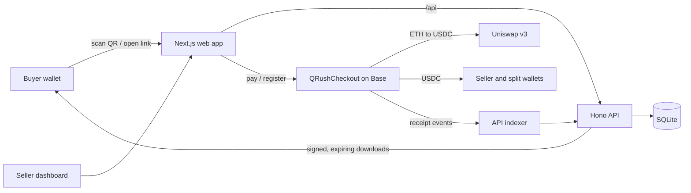

# QRush

QRush is a QR and pay-link checkout on Base. Customers pay with crypto; sellers receive USDC.

[](https://qrush.online)
[](https://basescan.org/address/0x6E41C4C993f0C2967eB9F8a3B27E9AD1E0dDb12e)
[](https://github.com/comzzy/qrush)
[](https://x.com/kane_120)
[](LICENSE)

- Live app: https://qrush.online
- Contract (verified): [`0x6E41C4C993f0C2967eB9F8a3B27E9AD1E0dDb12e`](https://basescan.org/address/0x6E41C4C993f0C2967eB9F8a3B27E9AD1E0dDb12e)

## The problem

- Accepting crypto requires knowledge of wallets, networks and tokens that most small sellers do not have.
- Customers hold different tokens, and volatile tokens expose the seller to price changes.
- Printed QR codes and shared links can be swapped or edited to redirect payments.

## The solution

- One QR code or pay link per product or amount, created in a few minutes.
- The buyer pays in USDC or ETH; the seller always receives the exact price in USDC.
- Payments go directly from the buyer to the seller's wallet through a public contract. QRush never holds funds.
- Amounts and recipients are fixed by the contract and the server, not by the link.

## Why QRush is different

Coinbase Commerce, Daimo Pay and Request also take crypto payments. QRush is different in these ways:

- **No Coinbase account needed.** Sellers in any country only need a wallet on Base. Coinbase closed Commerce on March 31, 2026, and Coinbase Business only accepts businesses in the US or Singapore ([Coinbase Help](https://help.coinbase.com/en/transitioning-from-coinbase-commerce-to-coinbase-business)). QRush works everywhere, including markets Coinbase doesn't serve, such as Nigeria.
- **Any token in, USDC out, in one transaction** through Uniswap v3.
- **Every kind of business:** in-person pickup codes, delivery, bookings and digital downloads. Sold PDFs are stamped with the buyer and order code, and every file gets a fingerprint.
- **Passkey wallet for buyers** who don't have a wallet app.
- **QR stickers** that open a checkout with a verified-shop panel, checked onchain.
- **Snap your price list:** a photo of a menu or price list becomes products.

### Side-by-side comparison

Taken from each product's public docs (checked November 2026). "—" means the feature is not listed there.

| Feature | QRush | Daimo Pay | Request Network | Coinbase Commerce |
|---|---|---|---|---|
| Status | Live on Base | Live | Live | Closed March 31, 2026 |
| Set up by | Shop owner, no code | Developers (SDK + API key) | Dashboard or API | — |
| Any token in, stablecoin out | ✓ One transaction (Uniswap v3) | ✓ Any chain, any token | ✓ Cross-chain swap-to-pay | Hundreds of assets |
| Fee | No platform fee, gas only | Not listed in docs | Protocol fee on every payment | 1% |
| Needs a Coinbase business account | No | No | No | Replaced by Coinbase Business (US and Singapore only) |
| Card, bank and local payment methods | No, crypto only | ✓ | — | — |
| Order types: pickup code, delivery, booking, digital | ✓ | — | — | — |
| Digital delivery with PDF stamping and file fingerprints | ✓ | — | — | — |
| QR stickers with an onchain verified-shop panel | ✓ | — | — | — |
| Photo of a price list turns into products | ✓ | — | — | — |
| Passkey wallet for buyers | ✓ | — | — | — |
| Payment splits and onchain loyalty stamps | ✓ | — | — | — |

Sources: [Daimo docs](https://docs.daimo.com/introduction), [Request Network docs](https://docs.request.network/), [Request Network protocol fees](https://docs.request.network/api-features/protocol-fees), [Coinbase Help](https://help.coinbase.com/en/transitioning-from-coinbase-commerce-to-coinbase-business).

## Who it's for

- Market stalls and food vendors: a QR sticker on the counter, buyers show a pickup code.
- Delivery businesses: collect address and phone with the order.
- Salons, tutors and service pros: take bookings, paid up front.
- Ebook and course sellers: PDFs stamped for each buyer.
- Shops with partners or staff: automatic splits between wallets.

## Why now

- QRush is for sellers worldwide. One example of demand: Sub-Saharan Africa received over $205B in crypto value from July 2024 to June 2025, up about 52% year over year. Nigeria alone received $92.1B, and more of the region's value moves in small transfers than elsewhere ([Chainalysis, Sept 2025](https://www.chainalysis.com/blog/subsaharan-africa-crypto-adoption-2025/)).
- Coinbase Business only accepts businesses in the US or Singapore, so most of the world's sellers need another option ([Coinbase Help](https://help.coinbase.com/en/transitioning-from-coinbase-commerce-to-coinbase-business)).

## Social preview and SEO

The site ships an Open Graph / Twitter card image (`web/app/opengraph-image.tsx`, 1200x630), an Apple touch icon, a web manifest, `robots.txt`, `sitemap.xml`, canonical URLs and JSON-LD (Organization and SoftwareApplication).

## How it works

**Seller**

1. Open https://qrush.online/app and sign in with a passkey wallet or an existing wallet.
2. Create a shop with a name and city.
3. Add products by typing them or by uploading a photo of a price list, then review them.
4. Register the shop on Base once. This needs a small amount of ETH for the network fee.
5. Create a pay link, then print its QR code or share the link.
6. Track payments, orders and receipts on the dashboard.

**Buyer**

1. Scan the QR code or open the pay link.
2. Check the shop details and verification panel on the pay page.
3. Connect a wallet and pay with USDC or ETH.
4. Receive a receipt with an order code, order status and, for digital products, the download.

## Features

- **USDC or ETH payments.** ETH is swapped to USDC on Uniswap v3 in the same transaction (exact output, with a deadline and a maximum input; unused input is refunded).
- **Passkey wallet.** Sign in with fingerprint or face recognition. No seed phrase.
- **Split payments.** Divide each payment between several wallets, for example 70% to the seller and 30% to a supplier.
- **Onchain receipts and loyalty.** Every payment emits a receipt event. Sellers can set a discount for repeat customers in the contract.
- **Shop setup from a photo.** Upload a photo of a price list to fill in products.
- **Basename links.** Shops can be shown and shared by their Basename.
- **Live payments map.** Payments appear on a live map by shop city.
- **Order types.** In person (order code and QR for collection), delivery (address, shipped, delivered), booking (date and time, confirmed, done) and digital.
- **Buyer details.** For each order type, the seller sets every field (name, phone, address and others) to off, optional or required. Only the seller can see the answers.
- **Digital delivery.** Private files up to 50 MB (PDF or EPUB) or an external link, released after the payment is verified on Base. PDFs can be read in the browser.
- **Anti-theft for digital products.**
  - File fingerprint: a file already sold by another shop cannot be uploaded again, and the first upload is timestamped.
  - Each PDF copy is stamped with the buyer's name or email, order code and date.
  - Signed download links expire and work up to 5 times per order.
  - Sellers confirm ownership with an "I own the rights to sell this" tick.
  - Buyers can report a product from its pay page.

## Security

- **Edited links cannot change the amount or recipient.** Invoice IDs are signed by the seller (EIP-712), and amounts are stored in the contract. The price and seller always come from the contract and the server, never from the URL.
- **Protection against fake stickers.** The pay page shows a verification panel with the domain, shop name, Basename, seller wallet and QRush contract. A "Verified shop" badge appears only when the shop is registered in the QRush contract on Base.
- **Wallet-step guard.** The pay page refuses to send any wallet request that does not target the QRush contract.
- **Security headers.** HSTS and a Content Security Policy are set on every page.
- **Server-side verification.** The server confirms each payment on Base before it marks an order paid or releases a file.

No system can fully prevent piracy of digital files. The measures above make copying harder and make leaked copies traceable to an order.

## Fees

- QRush charges no platform fee.
- Buyers pay a small Base network fee in ETH for each payment. Sellers pay the same type of fee once to register their shop.
- The platform does not sponsor gas.

## Try it

1. Open https://qrush.online/app and create a shop with a passkey wallet.
2. Add one product and register the shop on Base.
3. Create a pay link, open it on a second device and pay with USDC.
4. Open the receipt and see the payment on the seller dashboard.

## Tech stack

| Layer | Technology |
| --- | --- |
| Smart contract | Solidity, Foundry, OpenZeppelin, Uniswap v3 |
| Network | Base mainnet, USDC |
| API | TypeScript, Hono, viem, SQLite with drizzle-orm, pdf-lib |
| Web | Next.js 16, React 19, wagmi, viem, Tailwind CSS 4, pdf.js |
| Tests | Foundry (unit and Base fork), Vitest, Playwright |
| Hosting | Vercel (web app serves the API under `/api`) |

## Architecture



## For developers

### Layout

```
contracts/   Foundry project: QRushCheckout contract, tests, deploy script
api/         TypeScript API (Hono, viem, SQLite + drizzle): sign-in, shops, invoices, indexer, feed
web/         Next.js app: landing page, seller dashboard, pay page, receipts, live map
```

The contract handles seller registration, payout splits, invoices and pay links (including EIP-712 signed ones), and payments in USDC, ETH or ERC20.

### Run locally

Requirements: Node 24, pnpm and [Foundry](https://book.getfoundry.sh/).

```bash
git clone https://github.com/comzzy/qrush.git && cd qrush
pnpm install

cd contracts
forge install foundry-rs/forge-std OpenZeppelin/openzeppelin-contracts --no-git
forge build
cd ..

cp api/.env.example api/.env              # RPC_URL, JWT_SECRET, CHECKOUT_ADDRESS, ...
cp web/.env.example web/.env.local        # site URL, WalletConnect project id
cp contracts/.env.example contracts/.env  # only needed to deploy

pnpm --filter qrush-api dev   # API on port 8787
pnpm --filter qrush-web dev   # web on port 3000
```

Do not commit `.env` files or keys. They are listed in `.gitignore`.

### Deploy the contract

```bash
cd contracts
source .env     # BASE_RPC_URL, BASESCAN_API_KEY, DEPLOYER_PRIVATE_KEY
./deploy-base.sh
```

## Tests

```bash
cd contracts && forge test                    # contract unit tests
forge test --fork-url $BASE_RPC_URL           # Base mainnet fork tests
pnpm --filter qrush-api test                  # API tests
pnpm --filter qrush-web e2e                   # browser tests
```

### Known limits

- Paying in ETH for a signed invoice that is not yet published takes two transactions from a standard wallet. Smart wallets need one.
- Prices are in USDC. Imported price lists in other currencies are flagged, not saved.
- File fingerprints are stored off-chain.
- SQLite runs on a single node. Run one API instance per database file.

## Roadmap

- Automatic buyer notifications by email and WhatsApp (today sellers use one-tap email and WhatsApp links).
- Buyer stamping for EPUB files.
- An onchain registry for file fingerprints.
- Multi-instance database support for the API.

## License

MIT. See [LICENSE](LICENSE).
